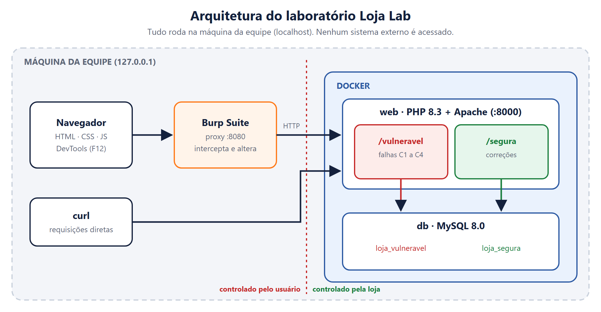

# Etapa 3 – Atividade Prática

**Instituição:** Universidade Tiradentes (UNIT)  
**Disciplina:** Segurança da Informação  
**Professor:** Prof. Msc. Felipe Lima  
**Tema 4:** Segurança em aplicações Web  
**Equipe:** Daniel de Oliveira Mendonça Mota · Wilia Francisco da Silva

---

## 1. Objetivo da atividade

Demonstrar, em um ambiente próprio e controlado, o problema estudado na Etapa 2: **a confiança indevida nas entradas do usuário**. Para isso, a equipe desenvolveu uma loja virtual fictícia, a **Loja Lab**, em duas versões:

- **versão vulnerável**, com quatro falhas inseridas de propósito;
- **versão segura**, a mesma loja com as falhas corrigidas.

O mesmo ataque é feito nas duas versões. Assim, fica visível tanto o **impacto** de cada falha quanto a **eficácia** da correção.

---

## 2. Ambiente

### 2.1 Arquitetura



*Figura 1 – Arquitetura do laboratório. Fonte: elaborada pela equipe (2026).*

Todo o laboratório roda no computador da equipe:

| Componente | Tecnologia | Função |
|---|---|---|
| Servidor Web | PHP 8.3 + Apache, em contêiner Docker | Executa as duas versões da loja, na porta 8000 |
| Banco de dados | MySQL 8.0, em contêiner Docker | Dois bancos separados: `loja_vulneravel` e `loja_segura` |
| Orquestração | Docker Compose | Liga o laboratório inteiro com um comando |

**Medidas de isolamento:**
- a porta 8000 está ligada só ao endereço `127.0.0.1`, então nenhum outro computador da rede acessa a loja;
- cada versão tem banco e sessão próprios, e os ataques na versão vulnerável não afetam a segura;
- todos os dados são fictícios (nomes, CPFs, endereços e e-mails inventados);
- o laboratório pode ser zerado a qualquer momento (`docker compose down -v`).

### 2.2 A aplicação

A Loja Lab imita uma loja virtual real: vitrine com busca e categorias, página de produto, compra, área do cliente ("Meus pedidos" e "Meus dados") e painel administrativo com indicadores.

**Contas de teste:**

| Usuário | Senha | Perfil | Pedidos iniciais |
|---|---|---|---|
| `ana` | `ana123` | cliente | nº 1 e nº 3 |
| `bruno` | `bruno123` | cliente | nº 2 |
| `admin` | `admin123` | administrador | — |

Para que as **únicas** falhas da versão vulnerável fossem as quatro estudadas, as duas versões usam boas práticas no restante do código: senhas com `password_hash`, consultas parametrizadas (*prepared statements*) e escape de saída com `htmlspecialchars`.

---

## 3. Ferramentas utilizadas

| Ferramenta | Finalidade na atividade |
|---|---|
| **Docker Desktop / Docker Compose** | Montar o laboratório isolado e reproduzível |
| **Navegador + DevTools (F12)** | Ver o código-fonte, os campos ocultos e as requisições (aba *Network*) |
| **Burp Suite Community** | Interceptar a requisição antes de chegar ao servidor e alterar os valores |
| **curl** | Enviar requisições forjadas direto ao servidor, sem passar pelo navegador |
| **Logs do servidor** (`docker compose logs`) | Registrar as tentativas bloqueadas pela versão segura |

---

## 4. Procedimentos

O procedimento completo, passo a passo, está no guia [`laboratorio/README.md`](../laboratorio/README.md). De forma resumida:

1. Zerar o laboratório, para partir sempre do mesmo estado inicial.
2. Entrar como a cliente `ana`.
3. Para cada cenário:
   - mostrar o ponto fraco (código-fonte, formulário ou URL);
   - executar o ataque na **versão vulnerável** e registrar o resultado;
   - executar o **mesmo ataque** na **versão segura** e registrar o bloqueio.
4. Consultar os logs da versão segura.

### 4.1 C1 – Alteração do preço em campo oculto

- **Ponto fraco:** na página do *Notebook Pro 14*, o preço (R$ 2.499,90) está num campo oculto do formulário: `<input type="hidden" name="preco" value="2499.90">`.
- **Ataque:** ao clicar em "Comprar agora", a requisição foi interceptada no Burp e o corpo `produto_id=1&preco=2499.90&quantidade=1` foi alterado para `preco=0.01`.
- **Versão segura:** o formulário não tem mais o campo `preco`. A mesma requisição, com `preco=0.01` acrescentado, foi enviada.

### 4.2 C2 – Quantidade negativa (validação só no cliente)

- **Ponto fraco:** o limite de 1 a 5 unidades existe só no HTML (`min="1" max="5"`) e num JavaScript. Pelo navegador, o valor `-10` é bloqueado.
- **Ataque:** a requisição de compra do *Mouse sem fio* foi enviada direto ao servidor (curl e Burp) com `quantidade=-10`, contornando o navegador.
- **Versão segura:** mesma requisição.

### 4.3 C3 – Acesso ao pedido de outro cliente (IDOR)

- **Ponto fraco:** os detalhes do pedido são abertos por `pedido.php?id=1`, e o servidor não confere o dono do pedido.
- **Ataque:** logada como `ana`, a URL foi trocada para `pedido.php?id=2`, que é um pedido do cliente `bruno`.
- **Versão segura:** mesma URL.

### 4.4 C4 – Elevação para administrador (atribuição em massa)

- **Ponto fraco:** o formulário "Meus dados" só mostra nome, e-mail e endereço, mas o servidor grava qualquer campo recebido que tenha o nome de uma coluna da tabela `usuarios`.
- **Ataque:** primeiro, confirmou-se que `ana` não acessa o painel admin (HTTP 403). Depois, a requisição de "Salvar alterações" foi interceptada e o campo `&perfil=admin` foi acrescentado ao corpo.
- **Versão segura:** mesma requisição.

---

## 5. Resultados

Os quatro cenários foram executados nas duas versões, a partir do estado inicial do laboratório:

| Cenário | Versão vulnerável | Versão segura |
|---|---|---|
| **C1** – preço alterado para R$ 0,01 | Pedido registrado por **R$ 0,01** | Pedido registrado por **R$ 2.499,90**; o campo `preco` é ignorado |
| **C2** – quantidade `-10` | Pedido com total **R$ -899,00**, e o estoque do mouse **sobe de 50 para 60** | Compra **recusada (HTTP 400)**, "Quantidade inválida"; estoque continua 50 |
| **C3** – Ana abre o pedido nº 2 | Exibe **nome, e-mail, CPF e endereço do Bruno** | **"Pedido não encontrado" (HTTP 404)** |
| **C4** – `perfil=admin` no perfil | Ana passa a acessar o **painel admin** (HTTP 200), com dados de todos os clientes | Campo ignorado; Ana continua **sem acesso (HTTP 403)** |

Também foram conferidos na versão segura: quantidade `99` e `abc` recusadas, e-mail inválido recusado no perfil, compra normal funcionando, cliente vendo os próprios pedidos e administrador vendo todos.

**Registros da versão segura** (`docker compose logs web | grep loja-segura`):

```
[loja-segura] usuario 1 enviou campo 'preco' na compra; ignorado
[loja-segura] usuario 1 tentou abrir o pedido 2; negado
[loja-segura] usuario 1 enviou campos extras no perfil (ignorados): perfil
```

### 5.1 Evidências

As figuras abaixo são os prints da execução. Os arquivos ficam na pasta [`evidencias/`](../evidencias/), e a lista completa, com a legenda de cada um, está em [`evidencias/README.md`](../evidencias/README.md).

| Cenário | Figuras |
|---|---|
| C1 | `C1-01` código-fonte com o campo oculto · `C1-02` requisição original no Burp · `C1-03` requisição alterada · `C1-04` pedido por R$ 0,01 · `C1-05` versão segura cobrando R$ 2.499,90 |
| C2 | `C2-01` navegador bloqueando `-10` · `C2-02` requisição com `-10` · `C2-03` pedido com total negativo · `C2-04` estoque 60 · `C2-05` versão segura recusando (400) |
| C3 | `C3-01` pedido nº 1 da Ana · `C3-02` pedido nº 2 com os dados do Bruno · `C3-03` versão segura: "Pedido não encontrado" |
| C4 | `C4-01` acesso negado ao painel · `C4-02` requisição com `perfil=admin` · `C4-03` Ana no painel admin · `C4-04` versão segura: acesso negado |
| Logs | `logs-01` tentativas registradas pela versão segura |

---

## 6. Análise dos resultados

Os quatro cenários confirmam a ideia central da Etapa 2: **o que vem do navegador está sob controle do usuário**. Em todos eles, a página parecia "correta" para um usuário comum. As falhas só aparecem para quem altera a requisição.

| Cenário | Por que a falha acontece | Classificação | Impacto observado |
|---|---|---|---|
| C1 | Dado sensível (preço) enviado ao cliente e aceito de volta | CWE-472 · OWASP A06 (Insecure Design) | Prejuízo financeiro direto |
| C2 | Regra de negócio só no HTML/JS; `(int)` converte, mas não valida | CWE-602, CWE-20 · OWASP A06 | Pedido negativo e estoque corrompido |
| C3 | Falta de controle de acesso por objeto | CWE-639 · OWASP A01 (Broken Access Control) | Vazamento de dados pessoais (LGPD) |
| C4 | Servidor grava campos que o usuário não deveria controlar | CWE-915 · OWASP A01 | Elevação de privilégio e acesso a dados de todos os clientes |

**Observações:**

- **Esconder não é proteger.** O campo `hidden` (C1) e o limite `max="5"` (C2) estavam no código-fonte, visíveis para qualquer um com F12.
- **Validar no cliente não é validar.** O bloqueio do navegador no C2 é contornado sem nenhum esforço por uma requisição direta.
- **Converter tipo não é validar.** No C2, `(int) "-10"` vira `-10` sem erro. Só uma validação de intervalo no servidor resolve.
- **A tela certa não garante o acesso certo.** No C3, a lista "Meus pedidos" mostrava só os pedidos da Ana, mas a página de detalhe não conferia o dono.
- **HTTPS não resolveria nenhum dos casos.** O HTTPS protege os dados no caminho, mas quem altera a requisição é o próprio usuário, antes da criptografia.

---

## 7. Medidas de proteção aplicadas

Cada correção da versão segura aplica uma medida estudada na Etapa 2. As diferenças completas entre as duas versões estão no [Apêndice A](#apêndice-a--comparação-do-código).

| Cenário | Correção na versão segura |
|---|---|
| C1 | O preço é buscado **no banco de dados** pelo `produto_id`; o formulário não tem mais o campo `preco` |
| C2 | **Validação no servidor** com `filter_input(..., FILTER_VALIDATE_INT, min_range 1, max_range 5)`, conferência de estoque e transação no banco |
| C3 | **Controle de acesso por objeto:** a consulta exige `usuario_id` igual ao do usuário logado (exceto admin), com resposta igual para "não existe" e "não é seu" |
| C4 | **Lista de campos permitidos** (*allowlist*): só `nome`, `email` e `endereco`, cada um validado; os demais são ignorados |
| Todos | **Registro (log)** das tentativas suspeitas, para monitoramento |

---

## 8. Conclusão da etapa

A atividade prática demonstrou que as quatro falhas são **fáceis de explorar**: bastam o navegador, o Burp Suite ou o curl, sem conhecimento avançado. Também são **graves**: causam prejuízo financeiro, vazamento de dados pessoais e elevação de privilégio. Ao mesmo tempo, as correções são **simples**: poucas linhas de código, todas seguindo um mesmo princípio:

> **O servidor nunca deve confiar no cliente.** Valores sensíveis vêm do servidor, toda entrada é validada no servidor e todo acesso a um recurso é autorizado no servidor.

---

## Apêndice A – Comparação do código

Trechos das duas versões. Arquivos completos em `laboratorio/www/vulneravel/` e `laboratorio/www/segura/`.

### C1 – Preço (`produto.php` e `comprar.php`)

**Vulnerável:**

```php
<!-- produto.php -->
<input type="hidden" name="produto_id" value="<?= (int) $p['id'] ?>">
<input type="hidden" name="preco" value="<?= h($p['preco']) ?>">

// comprar.php
$preco = (float) ($_POST['preco'] ?? 0);
$total = $preco * $quantidade;
```

**Segura:**

```php
<!-- produto.php: só o id do produto vai no formulário -->
<input type="hidden" name="produto_id" value="<?= (int) $p['id'] ?>">

// comprar.php: o preço vem do banco
$st = $pdo->prepare('SELECT preco, estoque FROM produtos WHERE id = ? FOR UPDATE');
$st->execute([$produto_id]);
$produto = $st->fetch();
$preco = $produto['preco'];
$total = $preco * $quantidade;
```

### C2 – Quantidade (`comprar.php`)

**Vulnerável:**

```php
// (int) converte, mas não valida: "-10" vira -10
$quantidade = (int) ($_POST['quantidade'] ?? 0);
```

**Segura:**

```php
$quantidade = filter_input(INPUT_POST, 'quantidade', FILTER_VALIDATE_INT,
    ['options' => ['min_range' => QTD_MIN, 'max_range' => QTD_MAX]]);

if ($quantidade === false || $quantidade === null) {
    recusar('Quantidade inválida: escolha entre ' . QTD_MIN . ' e ' . QTD_MAX . ' unidades.');
}
if ($produto['estoque'] < $quantidade) {
    $pdo->rollBack();
    recusar('Estoque insuficiente.');
}
```

### C3 – Dono do pedido (`pedido.php`)

**Vulnerável:**

```php
... WHERE pe.id = ?'
$st->execute([(int) ($_GET['id'] ?? 0)]);
```

**Segura:**

```php
$params = [(int) ($_GET['id'] ?? 0)];
if ($usuario['perfil'] !== 'admin') {
    $sql .= ' AND pe.usuario_id = ?';
    $params[] = $usuario['id'];
}
```

### C4 – Campos do perfil (`perfil.php`)

**Vulnerável:**

```php
$colunas = $pdo->query('SHOW COLUMNS FROM usuarios')->fetchAll(PDO::FETCH_COLUMN);
foreach ($_POST as $campo => $valor) {
    if ($campo !== 'id' && in_array($campo, $colunas, true)) {
        $sets[]    = "`$campo` = ?";   // inclusive "perfil"
        $valores[] = (string) $valor;
    }
}
```

**Segura:**

```php
// só estes três campos podem ser alterados, e cada um é validado
$nome     = trim((string) ($_POST['nome'] ?? ''));
$email    = trim((string) ($_POST['email'] ?? ''));
$endereco = trim((string) ($_POST['endereco'] ?? ''));
// ... validações ...
$pdo->prepare('UPDATE usuarios SET nome = ?, email = ?, endereco = ? WHERE id = ?')
    ->execute([$nome, $email, $endereco, $usuario['id']]);
```
